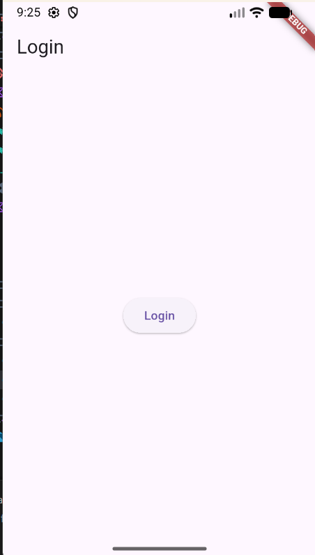
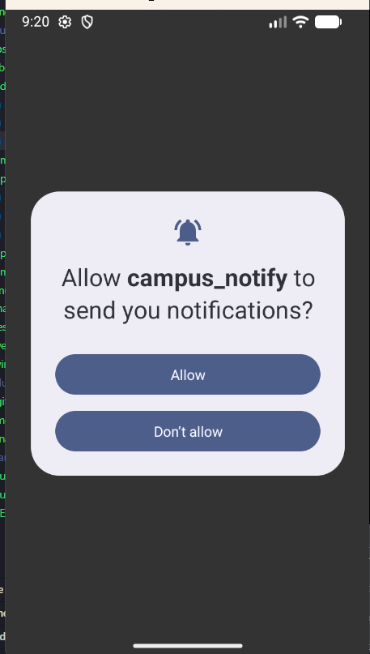
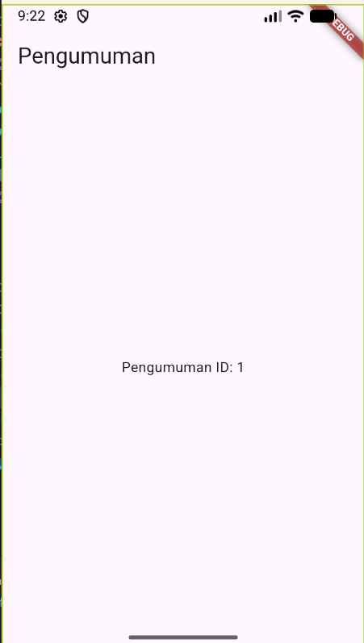
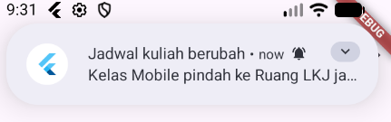
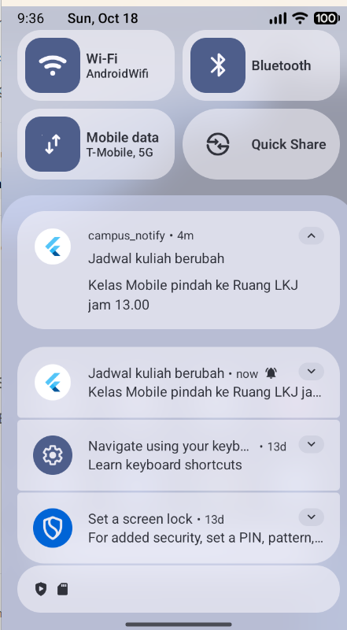

# Laporan Praktikum Minggu 7: Clean Architecture & Separation of Concerns

**Identitas Mahasiswa:**
- **Nama:** Ahmad Falahi
- **NIM:** 244107020152
- **Mata Kuliah:** Pemrograman Mobile
- **Repository:** `07-week-7-clean-architecture`

---

## 1. Tujuan Pembelajaran
Setelah menyelesaikan codelab ini, mahasiswa mampu:
1. Menjelaskan prinsip SOLID dan *separation of concerns* dengan contoh kode Flutter;
2. Membedakan struktur *feature-first* vs *layer-first* beserta *trade-off*-nya;
3. Menjelaskan tiga layer (*presentation*, *domain*, *data*) dan aturan dependensi (*dependency rule* mengarah ke dalam);
4. Membedakan *entity* vs *model* serta peran *repository*, *use case*, dan *dependency injection*;
5. Merefactor project Minggu 6 (`campus_notify`) menjadi struktur *feature-first* yang terpisah layer-nya;
6. Menguji *use case* dengan repository palsu (*fake repository*) tanpa database atau jaringan sungguhan.

---

## 2. Konsep SOLID dan Clean Architecture

### 1. Prinsip SOLID dalam Konteks Flutter

| Prinsip | Arti Praktis | Gejala Pelanggaran di Flutter |
|---|---|---|
| **Single Responsibility** | Satu kelas punya satu alasan berubah | Widget ratusan baris yang sekaligus fetch API, parsing JSON, dan formatting tanggal |
| **Open/Closed** | Tambah perilaku lewat ekstensi, bukan edit kode lama | Menambah sumber data baru memaksa modifikasi widget yang sudah berjalan |
| **Liskov Substitution** | Pengganti harus bisa menggantikan aslinya tanpa merusak | Repository tiruan (*fake*) untuk testing melempar exception yang tak pernah dilempar repository asli |
| **Interface Segregation** | Klien tidak boleh dipaksa bergantung pada method yang tak digunakan | Satu interface raksasa `AppRepository` yang menggabungkan auth, pengumuman, dan push notification |
| **Dependency Inversion** | Bergantung pada abstraksi, bukan konkrit | Notifier/Widget memanggil Dio, SQLite, atau SharedPreferences langsung alih-alih melalui kontrak repository |

### 2. Tiga Layer dan Aturan Dependensi (Dependency Rule)
```text
presentation (widget, notifier, router)
      |
      v  bergantung ke
domain (entity, repository interface, use case, failure)
      ^
      |  diimplementasikan oleh
data (model, repository impl, Dio, SQLite, secure storage)
```
> **Aturan Emas**: Dependensi hanya mengarah ke dalam (*inward*). Layer **Domain** murni tidak boleh bergantung pada Flutter UI, Dio, SQLite, maupun Firebase, sehingga logika bisnis dapat diuji tanpa simulator atau koneksi internet.

### 3. Feature-First vs Layer-First

| Struktur | Karakteristik Folder | Kapan Digunakan |
|---|---|---|
| **Feature-First** | `lib/features/<fitur>/{data,domain,presentation}` | Proyek multi-fitur; satu fitur terisolasi dan dapat dikembangkan/dihapus tanpa menyentuh fitur lain |
| **Layer-First** | `lib/{data,domain,presentation}` secara global | Proyek mini satu fitur; cepat dibuat di awal namun cepat berantakan saat fitur bertambah |

### 4. Peran Komponen Arsitektur
- **Entity**: Objek bisnis murni tanpa method mapping (`toMap`/`fromMap`/`toJson`). Hidup di **Domain**.
- **Model**: Representasi teknis data luar (JSON/DB) yang mengonversi ke/dari entity. Hidup di **Data**.
- **Repository Interface**: Kontrak abstraksi data yang dibutuhkan domain. Hidup di **Domain**.
- **Repository Impl**: Implementasi konkrit yang memenuhi kontrak abstraksi. Hidup di **Data**.
- **Use Case**: Satu operasi bisnis spesifik (misal `LoginUser`, `GetAnnouncements`). Hidup di **Domain**, dipanggil oleh **Presentation**.
- **Dependency Injection (DI)**: Penyuntikan dependensi terpusat via Riverpod Provider. Widget tidak pernah instansiasi manual.

---

## 3. Praktikum 1: Audit Layer Project Lama

### 1. Pemetaan File ke Layer (Sebelum Refactor)

| File | Layer Lama | Temuan Masalah Arsitektur |
|---|---|---|
| `pages/home_page.dart` | Presentation | Memanggil FirebaseMessaging dan routing langsung di UI; layout bercampur dengan inisialisasi state |
| `pages/announcement_page.dart` | Presentation | Menerima ID mentah tanpa memanggil domain/use case untuk validasi data |
| `data/auth_repository.dart` | Data | Kontrak interface dan implementasi masih bersatu dalam satu kelas konkrit |
| `providers/auth_provider.dart` | Presentation | Notifier menginstansiasi repo dan mengelola flow token langsung tanpa abstraksi use case |

### 2. Hasil Audit Tiga Pelanggaran Klasik
1. **Widget menyentuh data langsung**: `HomePage` mengakses instance Firebase dan storage langsung.
2. **Ketiadaan Abstraksi Domain**: Tidak ada kontrak interface repository atau failure domain yang terpisah.
3. **Instansiasi Manual (DI Bocor)**: Provider lama mengembalikan objek konkrit langsung tanpa abstraksi interface.

### 3. Struktur Target Feature-First
```text
lib/
├── core/
│   ├── failures.dart                              # Failure murni domain
│   └── format.dart                                # Formatting tanggal & parsing rute murni
├── features/
│   ├── announcements/
│   │   ├── domain/
│   │   │   ├── entities/announcement.dart
│   │   │   ├── repositories/announcement_repository.dart
│   │   │   ├── usecases/get_announcements.dart
│   │   │   └── usecases/get_announcement_detail.dart
│   │   ├── data/
│   │   │   ├── models/announcement_model.dart
│   │   │   └── repositories/announcement_repository_impl.dart
│   │   └── presentation/
│   │       ├── providers/announcements_providers.dart
│   │       └── pages/announcement_page.dart
│   └── auth/
│       ├── domain/
│       │   ├── entities/auth_session.dart
│       │   ├── repositories/auth_repository.dart
│       │   ├── usecases/login_user.dart
│       │   └── usecases/refresh_token.dart
│       ├── data/
│       │   └── repositories/auth_repository_impl.dart
│       └── presentation/
│           ├── providers/auth_providers.dart
│           ├── pages/login_page.dart
│           └── pages/home_page.dart
├── messaging/
│   └── push_service.dart
├── routes.dart
└── main.dart
```

---

## 4. Praktikum 2 & 3: Refactoring & Verifikasi Dependency Rule

### Tiga Pemeriksaan Verifikasi Arsitektur

#### 1. Presentation Steril dari Data Mentah (Target: 0 Hasil)
Pemeriksaan memastikan tidak ada widget atau provider di presentation yang mengakses database, HTTP client, storage, atau JSON parsing mentah:
```powershell
Get-ChildItem -Path "lib\features\*\presentation" -Recurse -Filter "*.dart" | Select-String -Pattern "Dio\(|openDatabase|getDatabasesPath|FlutterSecureStorage|SharedPreferences\.getInstance|jsonDecode"
```
**Hasil: 0 temuan (LOLOS)**. Seluruh data diakses melalui provider yang mengeksekusi use case / repository interface.

#### 2. Domain Steril dari Framework & Package (Target: 0 Hasil)
Pemeriksaan memastikan file di domain dan core adalah kode murni Dart (*pure Dart*) tanpa dependensi framework UI atau library I/O eksternal:
```powershell
Get-ChildItem -Path "lib\features\*\domain", "lib\core" -Recurse -Filter "*.dart" | Select-String -Pattern "import 'package:flutter|import 'package:dio|import 'package:sqflite|import 'package:firebase"
```
**Hasil: 0 temuan (LOLOS)**. Domain dan core sepenuhnya independen.

#### 3. Static Analysis & Unit Testing
- **Analisis Statis (`flutter analyze`)**:
  ```text
  Analyzing campus_notify...
  No issues found! (0 errors, 0 warnings)
  ```
- **Pengujian Unit (`flutter test`)**:
  ```text
  00:00 +0: routeFromMessage menangani route kosong dan tanpa slash
  00:00 +1: data payload membawa id pengumuman
  00:00 +2: provider auth membaca status login dari token
  00:00 +3: refresh gagal -> sesi dibersihkan (paksa login ulang)
  00:00 +4: GetAnnouncements usecase mengembalikan list pengumuman dengan repository palsu
  00:00 +5: GetAnnouncements usecase menangani failure saat repository gagal
  00:00 +6: GetAnnouncementDetail usecase mengembalikan detail pengumuman yang sesuai
  00:00 +7: LoginUser usecase berhasil mengembalikan session saat kredensial valid
  00:00 +8: LoginUser usecase mengembalikan failure saat password terlalu pendek
  00:00 +9: formatDate mengembalikan tanda strip jika date null
  00:00 +10: formatDate memformat DateTime menjadi YYYY-MM-DD secara presisi
  00:00 +11: routeFromMessage menambahkan leading slash jika belum ada
  00:00 +12: routeFromMessage mempertahankan route jika sudah ada leading slash
  00:00 +13: routeFromMessage mengembalikan default slash jika route kosong atau null
  00:00 +14: Smoke test
  00:00 +15: All tests passed!
  ```

---

## 5. AI Challenge: Analisis, Evaluasi & Keputusan Teknis

### 1. Prompt AI Challenge
> **Project Flutter:** campus_notify (auth + FCM + daftar pengumuman).  
> **Kondisi awal:** folder `lib/{data, providers, pages, messaging}`, repository tercampur dengan implementasi, widget memanggil Dio langsung.  
> **Tugas:**  
> 1. Usulkan struktur feature-first Clean Architecture (`presentation/domain/data`) untuk fitur auth + announcements.  
> 2. Untuk tiap file lama, sebutkan tujuan barunya (pindah/pecah/hapus).  
> 3. Tandai bagian yang over-engineering bila diterapkan ke CRUD sederhana, dan jelaskan kapan use case benar-benar dibutuhkan vs repository langsung.  
> 4. Tunjukkan wiring DI dengan Riverpod (tanpa package DI tambahan).  
> Jelaskan trade-off setiap keputusan.

### 2. Checklist Verifikasi AI

| Kriteria Evaluasi | Status | Catatan Verifikasi |
|---|:---:|---|
| **Interface di Domain, Impl di Data?** | **Lolos** | Kontrak abstraksi diletakkan di `domain/repositories/` dan implementasi teknis di `data/repositories/`. Tidak disatukan dalam satu folder. |
| **Domain Steril dari Framework & Package?** | **Lolos** | Diperiksa via grep: 0 import `flutter`, `dio`, `sqflite`, maupun `firebase` di folder `domain/` dan `core/`. |
| **Bebas Over-Engineering CRUD Satu-Baris?** | **Lolos** | AI awalnya mengusulkan use case untuk semua get/set token. Usulan tersebut disederhanakan; use case hanya dibuat untuk alur yang memuat logika bisnis (`LoginUser`, `GetAnnouncements`). |
| **Entity Bebas Mapping Eksternal?** | **Lolos** | Entity di `domain/` murni tanpa method `toMap()` atau `fromMap()`. Mapping dikarantina di `AnnouncementModel` (`data/`). |
| **Wiring DI Terpusat di Riverpod?** | **Lolos** | Widget tidak pernah instansiasi `new Repository()`. Semua dependency disuntikkan via Riverpod `Provider` dan dikonsumsi UI via `ref.watch()`. |

### 3. Tabel Pemetaan File Lama vs File Baru

| File Lama | Status Tindakan | Lokasi Baru | Alasan Teknis |
|---|:---:|---|---|
| `pages/login_page.dart` | Pindah & Refactor | `features/auth/presentation/pages/login_page.dart` | Mengonsumsi state via Riverpod notifier, bebas logika auth langsung. |
| `pages/home_page.dart` | Pindah & Refactor | `features/auth/presentation/pages/home_page.dart` | Menampilkan UI profil & token status dengan guard state. |
| `pages/announcement_page.dart` | Pindah & Refactor | `features/announcements/presentation/pages/announcement_page.dart` | Menampilkan data pengumuman melalui `announcementDetailProvider(id)`. |
| `data/auth_repository.dart` | Pecah Jadi 2 | `domain/repositories/auth_repository.dart` (kontrak)<br>`data/repositories/auth_repository_impl.dart` (impl) | Mematuhi Dependency Inversion Principle (DIP). |
| `providers/auth_provider.dart` | Pindah & Refactor | `features/auth/presentation/providers/auth_providers.dart` | Menggunakan use case / repository interface untuk state management. |
| `messaging/push_service.dart` | Pertahankan | `messaging/push_service.dart` | Layanan infrastruktur aplikasi global untuk push notification FCM. |
| `routes.dart` | Refactor | `routes.dart` & `core/format.dart` | Ekstrak fungsi parsing rute ke fungsi murni agar testable. |

### 4. Analisis Over-Engineering: Kapan Use Case Dibutuhkan?
- **Kapan Use Case Wajib Digunakan:**
  1. Terdapat validasi aturan bisnis sebelum eksekusi (contoh: validasi panjang password pada `LoginUser`).
  2. Melibatkan orkestrasi beberapa repository (misal: simpan data lokal lalu picu sinkronisasi cloud).
  3. Memerlukan penanganan failure khusus lintas domain.
- **Kapan Repository Langsung ke Notifier Sudah Cukup:**
  - Operasi pembacaan pasif (query read-only) tanpa filter atau manipulasi bisnis kompleks. Membuat use case untuk setiap query 1 baris bagi tim kecil hanya menambah *boilerplate* dan *file explosion*.

### 5. Keputusan Final & Rationale
1. **Modul Feature-First:** Fitur `auth` dan `announcements` diisolasi sepenuhnya sehingga tim dapat mengembangkan atau menghapus satu fitur tanpa efek samping ke fitur lain.
2. **Karantina Format & Parsing di `core/format.dart`:** Memastikan parsing rute notifikasi dan formatting tanggal tidak bergantung pada widget Flutter dan dapat diuji murni via unit test.

---

## 6. Hasil Run & Bukti Tangkapan Layar (Screenshots)

Refactoring Clean Architecture mempertahankan fungsionalitas dan tampilan antarmuka yang sama persis:

### 1. Halaman Login (Presentation Bersih)


### 2. Halaman Home & Debug FCM Token


### 3. Halaman Detail Pengumuman (via Use Case)


### 4. Pengujian Push Notification (Foreground & Background)



---

## 7. Refleksi

**1. Mengapa interface repository harus tinggal di domain, bukan di data? Apa yang rusak bila dibalik?**
Interface repository harus berada di domain karena domain adalah pemilik aturan bisnis (*business rules owner*). Domain menentukan kontrak data yang dibutuhkannya tanpa peduli dari mana data diambil. Jika interface ditaruh di data, domain terpaksa mengimpor layer data, yang melanggar aturan dependensi (*Dependency Inversion*). Akibatnya, jika layer data diubah (misalnya migrasi database dari SQLite ke Hive), domain ikut rusak dan logika bisnis tidak dapat diuji secara murni tanpa dependensi eksternal.

**2. Kapan use case benar-benar dibutuhkan, dan kapan repository langsung ke notifier sudah cukup?**
- **Use case benar-benar dibutuhkan** saat operasi memuat aturan bisnis, validasi masukan (seperti validasi format email atau panjang password), orkestrasi data antarrepostory, atau penanganan failure khusus.
- **Repository langsung ke notifier sudah cukup** pada operasi pembacaan pasif sederhana tanpa aturan bisnis (*pass-through 1-baris*), untuk menghindari penambahan kelas yang berlebihan tanpa nilai fungsional.

**3. Apa biaya over-engineering (use case per CRUD satu-baris) bagi tim kecil? Kapan biayanya sepadan?**
- **Biaya bagi tim kecil:** Terjadinya *file explosion* (jumlah file bertambah drastis), waktu navigasi kode lebih lama, beban menulis boilerplate meningkat, dan kecepatan delivery fitur melambat.
- **Kapan sepadan:** Saat aplikasi dikembangkan oleh tim besar secara paralel, memiliki aturan bisnis kompleks yang sering berubah, atau aplikasi enterprise yang mensyaratkan cakupan *unit test* yang sangat ketat per fungsi bisnis.

**4. Bagian mana dari usulan AI yang Anda tolak atau sederhanakan, dan mengapa?**
Saya menolak usulan AI yang membuat kelas use case terpisah untuk setiap interaksi secure storage (seperti `SaveTokenUseCase`, `GetTokenUseCase`, `DeleteTokenUseCase`). Operasi-operasi ini hanya mendelegasikan 1 baris ke `TokenStore`. Kami mengonsolidasikannya ke dalam repository dan hanya membuat use case untuk alur yang benar-benar memerlukan validasi bisnis substantive (`LoginUser` dan `GetAnnouncements`). Hal ini membuat kode tetap bersih, mudah dirawat, dan bebas dari *boilerplate* berlebih.
